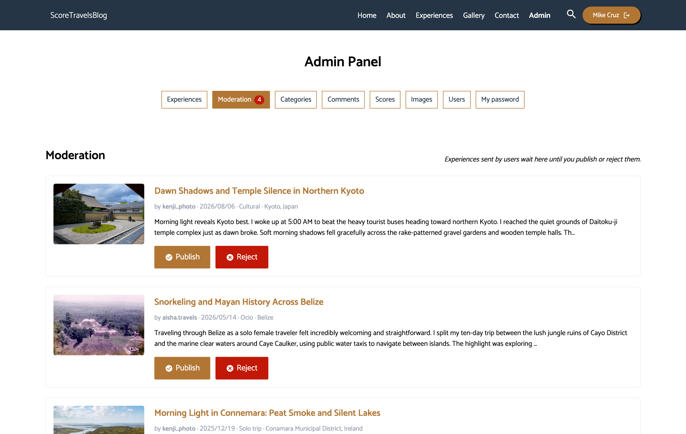
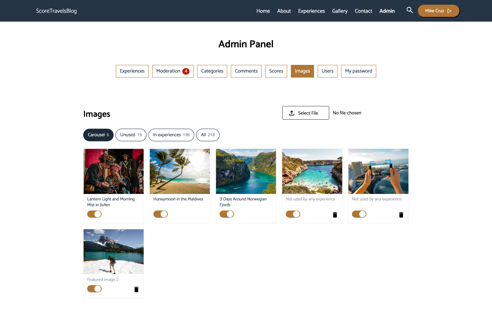

# ScoreTravelsBlog

Blog de viajes donde la gente comparte y puntúa sus experiencias. Los usuarios registrados escriben experiencias sobre una ciudad, una isla, una región o un país entero, las comentan y las valoran de 1 a 5 estrellas; un administrador modera las experiencias nuevas antes de publicarlas. La web incluye también una página About con la trayectoria profesional del autor, en español e inglés.

- **En producción:** https://scoretravelsblog.vercel.app (Vercel, MongoDB Atlas y Vercel Blob; ver [Despliegue](#despliegue)).
- **Stack:** React 19, TypeScript, Vite y Sass en el cliente; Node, Express 5 y Mongoose en el servidor.
- **Datos de demostración:** el contenido publicado es de ejemplo, con textos escritos por IA (Gemini). La mayoría de las experiencias, con sus autores ficticios, comentarios y votos, salen de `npm run seed`; sus fotos vienen de Wikimedia Commons, con el autor y la licencia en cada experiencia.
- **Para probarla:** cualquiera puede registrarse y enviar una experiencia, que queda pendiente hasta que un administrador la apruebe. La zona de administración necesita una cuenta de administrador; así se ve:

| Cola de moderación | Imágenes, por pestañas |
| --- | --- |
|  |  |

## Arquitectura

```
┌──────────────────────┐  archivos estáticos  ┌───────────────────────┐
│ client/              │ ◀─────────────────── │ CDN de Vercel         │
│ React + Vite (SPA)   │                      └───────────────────────┘
│ Zustand, react-router│                      ┌───────────────────────┐        ┌───────────────┐
│                      │  HTML y /api (JWT)   │ server/ (una función) │ ─────▶ │ MongoDB Atlas │
│                      │ ◀──────────────────▶ │ Express 5 (MVC)       │        └───────────────┘
│                      │                      │ zod, Mongoose, sharp  │ ─────▶ SMTP (Brevo)
│                      │                      └───────────┬───────────┘
│                      │                                  │ guarda las imágenes
│                      │  /static/images redirige         ▼
│                      │ ◀─────────────────── ┌───────────────────────┐
└──────────────────────┘                      │ Vercel Blob           │
                                              └───────────────────────┘
```

Todo funciona en un único origen. En producción, la CDN de Vercel sirve los archivos del cliente (`client/dist`), y Express, como una función de Vercel, atiende la API y el HTML. Las imágenes se piden siempre en `/static/images/...`, que redirige a la tienda de Blob; en local las sirve Express desde el disco.

### Servicios externos

| Servicio | Para qué | Desde |
| --- | --- | --- |
| [Photon](https://photon.komoot.io) (datos de OpenStreetMap) | Buscar el lugar de una experiencia mientras se escribe | Navegador (permitido en la CSP) y script de seed |
| CARTO / OpenStreetMap | Mapas base de Leaflet | Navegador |
| Brevo (SMTP) | Formulario de contacto y aviso de moderación al admin | Servidor |
| Vercel Blob | Imágenes subidas, cuando la app está desplegada en Vercel | Servidor |
| Gemini (Genkit) | Textos de ejemplo y clasificación de experiencias antiguas | Solo scripts (`seed`, `backfill`) |
| Wikimedia Commons | Fotos con licencia libre para las experiencias de ejemplo | Solo el script de seed |

### Cliente (`client/`)

- React 19, TypeScript (strict null checks), Vite, Sass.
- `src/api/`: llamadas tipadas a la API REST; `src/store/`: stores de Zustand; `src/hooks/`: hooks compartidos de datos y formularios.
- Formularios con react-hook-form + zod (`src/schemas/`), con las mismas reglas que valida el servidor.
- Mapa de la portada con Leaflet / react-leaflet y mapas base de CARTO (sin clave usa OpenStreetMap): las 5 mejores experiencias de cada continente, con una ventana con foto, título enlazado, lugar, estrellas y categoría. La rueda solo hace zoom con Ctrl/⌘ pulsado, para no secuestrar el scroll de la página.
- Listado y galería con buscador (título, contenido, categoría, lugar o país) y filtros por continente y país, que se calculan en el servidor.
- Lugares: al crear una experiencia se busca la ciudad, isla, región o país con Photon; las fotos que vienen de Wikimedia Commons muestran su autor y licencia.
- Página About (`/about`): una carretera con scroll horizontal propio que recorre los hitos de la carrera, con i18next (español por defecto e inglés) cargado solo en esa página.
- Zona `/admin`: cola de moderación, experiencias, categorías, usuarios, comentarios, puntuaciones e imágenes (por pestañas: carrusel de la portada, sin usar, en experiencias y todas).

### Servidor (`server/`)

- Express 5 con rutas → controladores → servicios → modelos de Mongoose; todas las rutas cuelgan de `/api`.
- Validación de peticiones con zod (`utils/schemas.js`) y un gestor de errores central.
- Autenticación: JWT (HS256) en la cabecera `Authorization`, contraseñas con argon2, roles `user` y `admin`. Cada usuario puede cambiar su contraseña (Admin → My password) o recuperarla por email con un enlace de un solo uso que caduca en 1 hora; en ambos casos se cierran las sesiones abiertas. El rol se lee de la base de datos en cada petición, así que bajar de rol o borrar un usuario se aplica al momento.
- Seguridad: helmet (CSP), lista blanca de CORS, rate limiting con contadores compartidos en MongoDB en las rutas sensibles, comprobación de subidas (tipo, tamaño) y conversión a AVIF con sharp.
- Las experiencias tienen autor y estado de moderación (`pending`, `published`, `rejected`); el admin recibe un email con cada envío nuevo.
- Cada experiencia apunta a un lugar (colección `cities`) de tipo `city` (ciudad, isla o región) o `country` (país entero), con país, continente y coordenadas.
- Endpoints de lectura para la portada y los filtros: `/api/experiences/facets` (categorías, continentes, países y años con experiencias), `/api/experiences/map` (las 5 mejores de cada continente) y `/api/experiences/timeline` (la mejor de cada año).
- SEO: el servidor escribe en `index.html` el título, la descripción y la imagen de cada experiencia (para las vistas previas en redes sociales) y genera `robots.txt` y `sitemap.xml`.
- Logs estructurados con pino: JSON en producción y texto legible en desarrollo. Cada petición lleva un ID (cabecera `X-Request-Id`, que también se devuelve en los errores 500) para encontrarla en los logs.
- La configuración se valida al arrancar (`config.js`), así que si falta una variable falla enseguida.

## Requisitos

- Node.js 22.22 o superior (ver `.nvmrc`; con nvm: `nvm install` y `nvm use` en la raíz) y npm 11.
- Docker, para la base de datos de desarrollo (o cualquier MongoDB).
- Para `npm run backup`: [MongoDB Database Tools](https://www.mongodb.com/docs/database-tools/) (`mongodump`; en macOS, `brew install mongodb-database-tools`).
- Opcional: una [clave de CARTO](https://carto.com/basemaps/apikey), credenciales SMTP de Brevo y una [clave de Gemini](https://aistudio.google.com/apikey) (solo para los scripts de seed y backfill).

## Puesta en marcha

```bash
# 1. Instalar dependencias
cd server && npm install
cd ../client && npm install

# 2. Configurar variables de entorno
cp server/.env.template server/.env      # como mínimo ATLAS_URL y JWT_SECRET
cp client/.env.example client/.env.local # opcional: VITE_CARTO_API_KEY

# 3. Levantar la base de datos de desarrollo (en server/.env: ATLAS_URL=mongodb://localhost:27017/project)
docker compose up -d

# 4. Arrancar cliente y servidor a la vez (desde client/)
npm run rundev
```

La base local empieza vacía. Para trabajar con datos reales, añade `ATLAS_URL_PROD` a `server/.env` y, desde `server/`, copia la base de datos y las imágenes (producción solo se lee):

```bash
npm run db:dev:copy
npm run backup:images -- https://scoretravelsblog.vercel.app uploads/images
```

El cliente queda en `http://localhost:5173` y la API en `http://localhost:3040/api`.

### Local y producción

Producción es la fuente de verdad, y la base de datos local es una copia que se puede tirar cuando se quiera. Por eso nada de lo que se prueba en local llega a la web.

| Qué cambia | Dónde se hace | Cómo llega al otro entorno |
| --- | --- | --- |
| Contenido (experiencias, comentarios, fotos) | En la web desplegada | A local, con `npm run db:dev:copy` y, si hay fotos nuevas, `backup:images` |
| Código, estilos y textos de About | En local | A producción, con git: al fusionar en `main`, Vercel despliega |
| Contraseñas | En la web (My password) o con `npm run users:set-password -- <usuario> --prod` | A local, con `npm run db:dev:copy` |
| Pruebas | En local | No llegan a producción |

Para actualizar la copia local, desde `server/`:

```bash
npm run db:dev:copy
npm run backup:images -- https://scoretravelsblog.vercel.app uploads/images
```

`db:dev:copy` **sustituye toda la base local**, así que lo probado en local se pierde. La copia solo va de producción a local, nunca al revés.

Los scripts escriben en `ATLAS_URL`, es decir, en local. Para ejecutar uno contra producción, como el seed, hay que pasarle la URL solo para ese comando, sabiendo que cambia datos reales. Las copias de seguridad (`backup`, `backup:images`) ya usan `ATLAS_URL_PROD` cuando existe.

## Variables de entorno

En local se leen de los archivos indicados en cada apartado. En Vercel se configuran en *Settings → Environment Variables*; la última columna indica qué hacer con cada una.

### Servidor (`server/.env`)

| Variable | Obligatoria | Descripción | En Vercel |
| --- | --- | --- | --- |
| `ATLAS_URL` | sí | Cadena de conexión de MongoDB | Sí |
| `ATLAS_URL_PROD` | no | Base de datos de producción cuando `ATLAS_URL` es la local. La usan `db:dev:copy`, las copias de seguridad y `users:set-password -- --prod` | No |
| `JWT_SECRET` | sí | Secreto para firmar las sesiones (mínimo 32 caracteres aleatorios) | Sí, distinto al de local |
| `SITE_URL` | no | Dirección pública para el sitemap, las vistas previas en redes y los enlaces de recuperación de contraseña (sin ella, en producción no se envían); por defecto, el host de la petición | Sí |
| `TRUST_PROXY` | no | Número de proxies delante de la app | Sí, `1` |
| `BLOB_STORE_URL` | no | URL pública de una tienda de Vercel Blob. Con ella, las imágenes se guardan ahí en vez de en `UPLOADS_DIR` | Sí |
| `BLOB_STORE_ID` | no | Identificador de la tienda, para las credenciales OIDC | Automática, al conectar la tienda |
| `BLOB_READ_WRITE_TOKEN` | no | Credencial de la tienda para usarla fuera de Vercel, con `npm run images:to-blob` | No |
| `SMTP_HOST`, `SMTP_PORT`, `SMTP_USER`, `SMTP_PASS`, `SMTP_FROM`, `SMTP_TO` | no | Emails del formulario de contacto, de moderación y de recuperación de contraseña | Sí |
| `LOG_LEVEL` | no | `trace`, `debug`, `info` (por defecto), `warn`, `error`, `fatal` o `silent` | Opcional |
| `NODE_ENV` | no | `development` (por defecto), `production` o `test` | Automática (`production`) |
| `PORT` | no | Puerto de la API, `3040` por defecto | No se usa |
| `CORS_ORIGINS` | no | Orígenes permitidos, separados por comas (en local, el cliente de Vite) | No hace falta: mismo origen |
| `UPLOADS_DIR` | no | Carpeta de imágenes subidas, `server/uploads/images` por defecto | No se usa: disco de solo lectura |
| `CLIENT_DIST_DIR` | no | Carpeta con el `index.html` del cliente, `client/dist` por defecto | No: la fija `api/index.js` |
| `GEMINI_API_KEY` | no | Solo la usan los scripts de seed y backfill | No |

### Cliente (`client/.env.local`)

| Variable | Descripción | En Vercel |
| --- | --- | --- |
| `VITE_API_URL` | URL base de la API. Vacía usa `http://localhost:3040` en desarrollo y el mismo origen en producción | No |
| `VITE_CARTO_API_KEY` | Clave de CARTO para el estilo claro del mapa; sin ella se usa OpenStreetMap | Sí, de tipo *Config*: acaba en el JavaScript público |

## Scripts

### Cliente

| Comando | Descripción |
| --- | --- |
| `npm run dev` | Servidor de desarrollo de Vite |
| `npm run rundev` | Cliente y servidor a la vez (Vite espera a que la API responda en `/api/health`) |
| `npm run build` | Comprobación de tipos y build de producción en `client/dist` |
| `npm run lint` / `npm run typecheck` | ESLint y comprobación de TypeScript |
| `npm test` / `npm run test:run` | Tests unitarios con Vitest (modo watch / una pasada) |
| `npm run test:e2e` | Tests end-to-end con Playwright (levanta su propio servidor con una base de datos en memoria) |

### Servidor

| Comando | Descripción |
| --- | --- |
| `npm start` / `npm run dev` | Arranca la API (en dev recarga con nodemon) |
| `npm test` | Tests de la API con node:test, supertest y MongoDB en memoria |
| `npm run lint` / `npm run format` | ESLint y Prettier |
| `npm run seed` | Genera experiencias de ejemplo: texto con Gemini, lugares con Photon y fotos de Wikimedia Commons (con su crédito), más usuarios ficticios, comentarios y votos. Por defecto 5 por continente (`npm run seed -- --per-continent=2 --continents=europe,asia`, o `--dry-run` para ver solo el texto) |
| `npm run seed:clear` | Cuenta el contenido creado por el seed; con `-- --yes` lo borra (experiencias, comentarios, votos, fotos, usuarios y lugares sin usar) |
| `npm run scores:recalculate` | Recalcula la media de cada experiencia a partir de las puntuaciones |
| `npm run backfill:propose` / `npm run backfill:apply` | Propone con Gemini categorías y ciudades para experiencias antiguas y aplica la propuesta revisada |
| `npm run users:set-password -- <usuario o email> [--prod]` | Cambia la contraseña de un usuario desde la terminal, sin mostrarla (mínimo 12 caracteres), y cierra sus sesiones |
| `npm run db:dev:copy` | Sustituye la base de datos local por una copia de producción, que solo se lee |
| `npm run images:to-blob` | Copia a Vercel Blob las imágenes de `UPLOADS_DIR` que aún no estén allí, sin borrar nada (con `-- --yes`; sin él solo las cuenta) |
| `npm run backup` | Copia de seguridad de la base de datos (`mongodump`) y las imágenes en `~/backups/scoretravelsblog` (o la carpeta que se le pase), guardando los últimos 14 días |
| `npm run backup:images -- <URL de la web>` | Descarga a `~/backups/scoretravelsblog/images` las imágenes nuevas de la web desplegada; no necesita credenciales de Blob |
| `npm run migrate:*` | Migraciones de datos puntuales, ya ejecutadas en producción |

## Tests y CI

- **Cliente:** Vitest + Testing Library, con MSW simulando la API.
- **Servidor:** node:test + supertest contra mongodb-memory-server; nunca se toca la base de datos real.
- **End-to-end:** Playwright prueba el cliente compilado contra la API y una base de datos en memoria (`client/e2e/`).
- **GitHub Actions** (`.github/workflows/ci.yml`) ejecuta lint, tipos, todas las suites de tests, el build y `npm audit` en cada push y pull request. Dependabot propone actualizaciones de dependencias cada semana.

## Despliegue

### Cómo se despliega

La web está en **Vercel**: cada cambio en `main` se despliega en producción, en https://scoretravelsblog.vercel.app, y las demás ramas generan una URL de prueba. La configuración está en [`vercel.json`](vercel.json), y el proyecto se despliega desde la raíz del repositorio:

- **Región:** `fra1`, junto a la base de datos de Atlas, para que las consultas no crucen un océano.
- **Cliente:** `client/dist` se sirve desde la CDN.
- **Servidor:** el resto de peticiones, HTML incluido, llegan a Express como una única función ([`api/index.js`](api/index.js)). Así la CSP y las etiquetas SEO se aplican igual que en local.
- **Instalación:** con npm 11, porque npm 10 rechaza el `package-lock` del servidor.

### Qué cambia respecto a un servidor con disco propio

- **Imágenes en Vercel Blob:** el disco de las funciones es de solo lectura. La tienda debe ser pública. `npm run images:to-blob` copia a la tienda las imágenes locales.
- **Subidas de hasta 4,5 MB:** es el límite por petición, así que el navegador reduce las fotos de más de 1 MB a 2000 px antes de enviarlas.

### Limitaciones conocidas

- **El rate limiting es por IP.** Las rutas sensibles comparten sus contadores entre instancias (ver [CHANGELOG](CHANGELOG.md)), lo que frena la fuerza bruta desde una IP, pero no un ataque repartido entre muchas. El límite global de la API y el de escrituras siguen en memoria: solo frenan abusos simples.
- **Atlas abierto a `0.0.0.0/0`.** Vercel no tiene IPs fijas en el plan gratuito, así que la red no protege la base de datos y todo depende de la credencial. Por eso la app usa un usuario dedicado con `readWrite` solo sobre esta base, nunca `atlasAdmin`, y con una contraseña larga autogenerada: una credencial filtrada no da acceso al resto de la cuenta.
- **Las copias de seguridad son manuales.** `npm run backup` guarda la base de datos y `UPLOADS_DIR`, y `npm run backup:images` descarga las imágenes de la web desplegada. Nada las programa, así que solo protegen hasta la última vez que se ejecutaron.
- **Las imágenes son públicas.** Las de experiencias pendientes o rechazadas se pueden abrir con su URL, y rechazar una experiencia no borra sus fotos. Es poco explotable en las subidas actuales, cuyo nombre lleva un UUID aleatorio; las más antiguas conservan nombres legibles.

### Alternativa: servidor propio

La app también funciona en un único servidor detrás de nginx con HTTPS, sin `BLOB_STORE_URL`, con las imágenes en disco:

1. `npm ci` en las dos carpetas y `npm run build` en `client/`.
2. En `server/.env`, poner `NODE_ENV=production`, `TRUST_PROXY=1` y los `CORS_ORIGINS` de producción.
3. Arrancar `server/index.js` con un gestor de procesos (pm2 o systemd) y hacer que nginx redirija al puerto 3040.
4. No borrar `server/uploads/` al desplegar y hacer copia de seguridad junto con la base de datos.

## Documentación

- [`CHANGELOG.md`](CHANGELOG.md): decisiones de seguridad e infraestructura, y por qué se tomaron.
- [`PLAN_MEJORAS.md`](PLAN_MEJORAS.md): plan de mejoras y su progreso.
